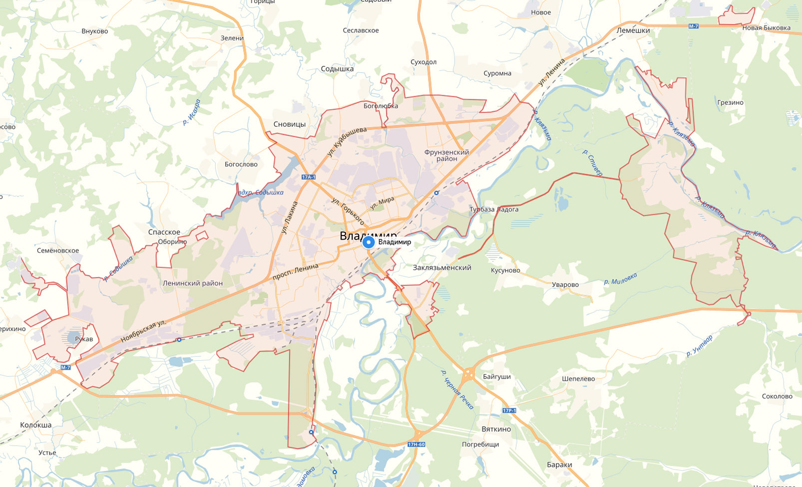

# EcoMonitorApp — документация пользователя

**EcoMonitorApp** — мобильное приложение для мониторинга экологии города и приём обращений граждан.

## Разделы

- [Руководство пользователя](guide/README.md)
- [Памятка по сортировке отходов](help/README.md)
- [Частые вопросы](help/faq/README.md)

## Полезные ресурсы

- [Сайт Росгидромета — данные о загрязнении атмосферы](https://www.meteorf.gov.ru)

Нажмите на карту, чтобы перейти к разделу о ней:

